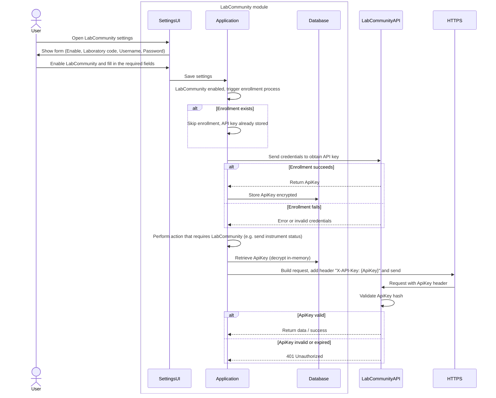

# LabCommunity Enrollment Process

Notes:
- The user provides credentials only once; the application exchanges them for an API key from the LabCommunity service.
- The returned API key is stored encrypted at rest in the application's database and never logged in plaintext.
- The application attaches the API key to outgoing requests to the LabCommunity API so credentials are not repeatedly sent.
