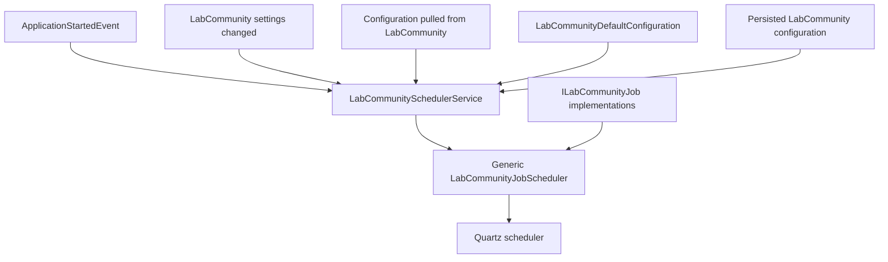
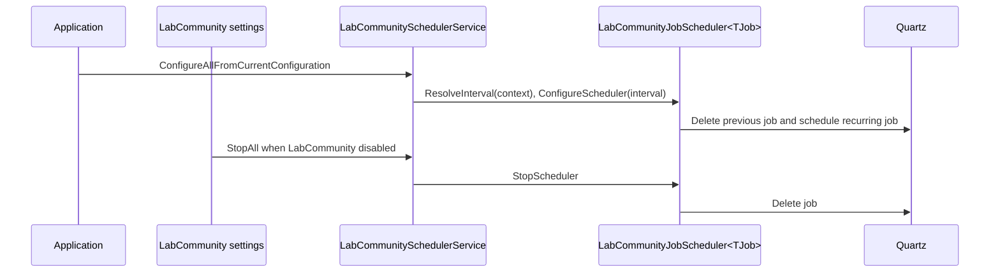
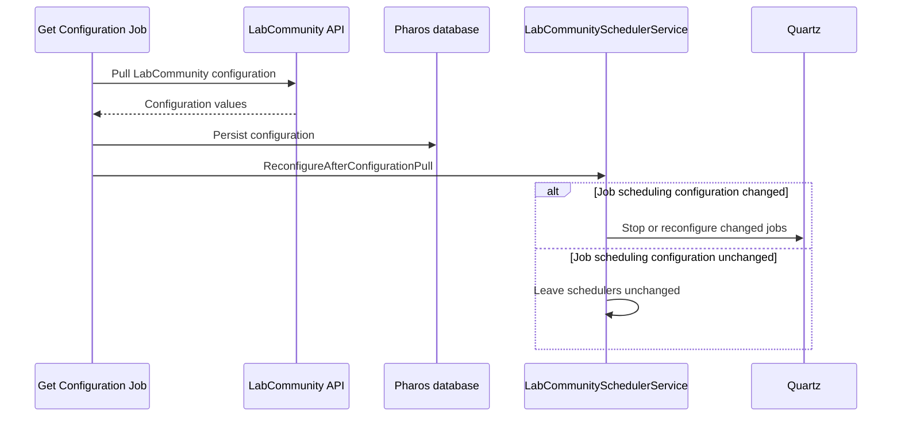
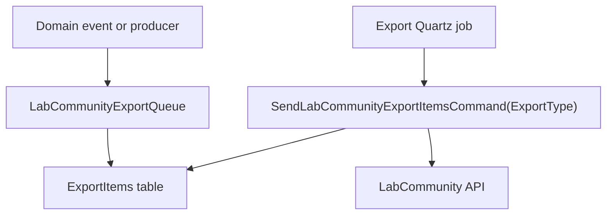
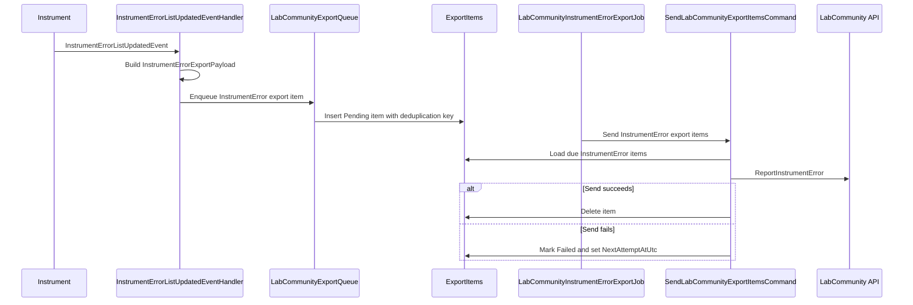

# LabCommunity Job Scheduling and Exports

This document describes how the Pharos LabCommunity module schedules recurring work and sends durable export items to LabCommunity.

The design has two related parts:

- Scheduler orchestration: configuring Quartz jobs when LabCommunity is enabled, disabled, or reconfigured.
- Export processing: storing outgoing data in the Pharos database first, then sending it to LabCommunity from recurring sender jobs.

## Goals

- Keep LabCommunity scheduling logic inside the LabCommunity module.
- Keep job-specific scheduling metadata and interval resolution with the job.
- Use one generic scheduler for all LabCommunity Quartz jobs.
- Store outgoing export work durably so queued work survives application restart or power loss.
- Let future export APIs share the same export table while still running on their own schedules.

## Scheduling Model

`LabCommunitySchedulerService` is the central entry point for scheduler configuration. It loads local defaults and persisted LabCommunity configuration, then asks each registered scheduler to resolve and configure its Quartz job.

Each `ILabCommunityJob` owns its job-specific metadata:

- Job key
- Trigger key
- Interval resolution
- Whether pulled configuration changes require reconfiguration

The generic `LabCommunityJobScheduler<TJob>` owns the repeated Quartz setup and stop behavior. The scheduler service owns group operations such as configure all, reconfigure after configuration pull, and stop all.

## Interval Resolution

Each `ILabCommunityJob` implements:

- `ResolveInterval(LabCommunityDefaultConfiguration defaultConfiguration, Configuration? configuration)`
- `ShouldReconfigureAfterConfigurationPull(Configuration? newConfiguration, Configuration? previousConfiguration)`

This avoids central interval enums and switch cases. A job can use the values relevant to its schedule:

- local defaults
- the currently effective persisted configuration
- the previous persisted configuration when comparing a configuration pull

At the moment, check-in and configuration pull both resolve to the check-in interval. Instrument error export resolves to the local default interval.

## Scheduler Lifecycle

Schedulers are configured when:

- The application starts and LabCommunity is enabled.
- LabCommunity settings change from disabled to enabled.

Schedulers are stopped when:

- LabCommunity settings change from enabled to disabled.

Each scheduler deletes its previous Quartz job before scheduling a new one. This makes reconfiguration deterministic and avoids duplicate triggers for the same logical job.

## Configuration Pull Reconfiguration

After a configuration pull, the command handler persists the freshly pulled configuration and passes the new persisted configuration together with the previous persisted configuration snapshot to the scheduler service. Each job's `ShouldReconfigureAfterConfigurationPull` method decides whether that job's interval or enabled flag changed. Only changed jobs are stopped or reconfigured, avoiding timer resets for unaffected jobs.

When changed jobs are reconfigured after a pull, each job's resolved interval is also used as its initial delay. This prevents an immediate extra scheduled call right after the configuration pull changed the schedule.

## Export Item Model

The export table is shared by all export APIs. Ownership is separated by `LabCommunityExportType`.

The current implemented export type is:

- `InstrumentError`
- `CurveControlResult`

Instrument errors are handled by:

- `InstrumentErrorListUpdatedEventHandler`
- `LabCommunityExportQueue`
- `LabCommunityInstrumentErrorExportJob`
- `LabCommunityJobScheduler<LabCommunityInstrumentErrorExportJob>`
- `SendLabCommunityExportItemsCommand(LabCommunityExportType.InstrumentError)`

The sender command only reads export rows matching the requested `ExportType`. This allows future export sender jobs to share the table while running at different intervals.

## Instrument Error Export Flow

Current instrument error behavior:

- Reporting is skipped when LabCommunity is disabled.
- Reporting is skipped when pulled LabCommunity configuration has instrument error reporting disabled.
- Each reported instrument error is stored as one export item.
- The payload version is stored with the item so payload shape changes can be handled later.
- The error text is currently a placeholder.
- Pharos performs local deduplication with `DeduplicationKey`.

Curve-control export items store the complete result snapshot needed for reporting.

## Export Item State

Export items are created as `Pending`.

The sender loads items when all of the following are true:

- `ExportType` matches the sender job.
- Status is `Pending` or `Failed`.
- `NextAttemptAtUtc` is empty or due.

When a send succeeds:

- The export item is deleted.

When a send fails:

- Status becomes `Failed`.
- `AttemptCount` is incremented.
- `LastAttemptAtUtc` is set.
- `LastError` is stored.
- `NextAttemptAtUtc` is set using the retry delay.

The Quartz job interval and retry delay are separate concepts. The interval controls how often Pharos checks for due work. The retry delay controls when a failed row is eligible for another attempt.

## Concurrency Notes

The export Quartz jobs are marked with `DisallowConcurrentExecution`, so Quartz will not run multiple copies of the same job concurrently in the same scheduler.

Future export jobs can share `ExportItems` safely as long as each sender strictly filters by its own `ExportType`. Separate jobs can read and update different export types in the same table.

If Pharos later needs multiple application instances processing the same LabCommunity export table, the export model may need database-level claiming, leasing, or row locking to prevent two instances from sending the same row. That is not part of the current single-instance design.

## Adding Future Export APIs

For a future export API with its own fixed run interval:

- Add a new `LabCommunityExportType`.
- Add a payload model and payload version.
- Add a producer that enqueues rows into `ExportItems` with that export type.
- Add a Quartz job implementing `ILabCommunityJob` that sends `SendLabCommunityExportItemsCommand(newExportType)`.
- Implement `ResolveInterval` and `ShouldReconfigureAfterConfigurationPull` on the job.
- Register `LabCommunityJobScheduler<NewJob>` as an `ILabCommunityJobScheduler`.
- Extend `SendLabCommunityExportItemsCommand` dispatching for the new export type.

For a future API whose interval must be configurable from LabCommunity:

- Persist the pulled interval in LabCommunity configuration.
- Implement that lookup in the job's `ResolveInterval`.
- Implement `ShouldReconfigureAfterConfigurationPull` so the job restarts only when its scheduling configuration changes.

Only add persisted configuration values when the interval is expected to come from LabCommunity configuration. Local-only intervals can resolve from `LabCommunityDefaultConfiguration`.