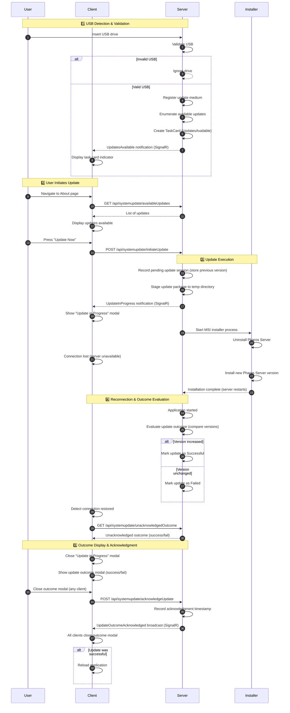
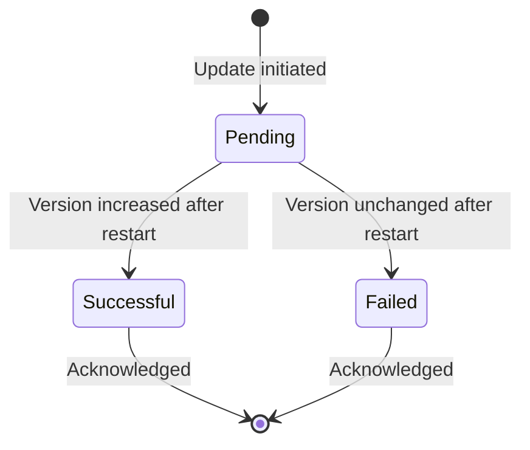

# System Update Sequence Diagram

This document describes the system update flow from USB insertion through update completion and acknowledgment.

## Overview

The system update process involves:
- **User**: Operator initiating the update
- **Client**: Blazor WebAssembly application running in the browser
- **Server**: Pharos.Server backend application
- **Installer**: Windows MSI installer process

## USB Update Package Prerequisites

- The USB root must contain an `Updates` folder, for example `E:\Updates`.
- The `Updates` folder must contain exactly one `.zip` package with the Pharos `.msi` installer inside.
  - Valid package path examples: 
    - `E:\Updates\Pharos_0.1.0.20007.zip` with `Pharos_0.1.0.20007.msi` inside.
    - `E:\Updates\PharosInstaller.zip\PharosInstaller` with `Pharos_0.1.0.20007.msi` inside. (Recursive extraction)

## Sequence Diagram

## Update Session States

